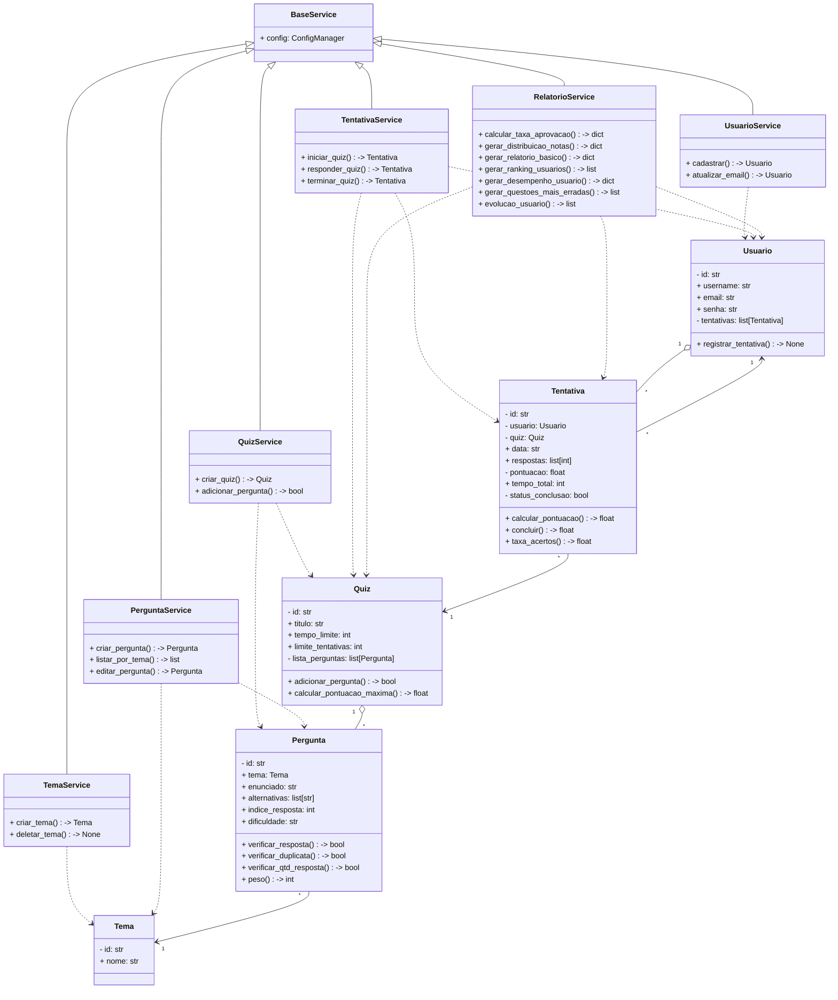

# Sistema de Quiz Educacional

## Descrição do Projeto
O Sistema de Quiz Educacional é um projeto que permite que os Usuários respondam e criem quizzes com título, perguntas, número máximo de tentativas e tempo limite. O Usuário poderá cadastrar perguntas de múltipla escolha, cada uma com um enunciado, alternativas, nível de dificuldade (Fácil, Médio e Difícil) e tema. Além disso, o Usuário poderá gerar diferentes tipos de relatórios que podem fornecer o seu desempenho no Quiz, ranking de usuários e evolução do desempenho do Usuário.

## Objetivo
Desenvolver um sistema que permita que Usuários possam criar, gerenciar e responder quizzes com perguntas de múltipla escolha, fornecendo pontuação, desempenho e evolução.

## Funcionalidades
* Cadastro e gerenciamento de usuários
* Cadastro e gerenciamento de temas
* Criação e gerenciamento de quizzes
* Cadastro, edição e exclusão de perguntas
* Perguntas de múltiplas escolhas com diferente níveis de dificuldade
* Realização de quizzes
* Registro de consulta e tentativas
* Geração de relatórios de desempenho
* Geração de ranking

# Instalação

## Requisitos
* Python 3.11 ou superior

## Clonar o Repositório
### Obrigatório

```bash
git clone https://github.com/EzequielFerreira35/sistema-de-quiz-educacional.git
cd sistema-de-quiz-educacional
```
### Opcional
```bash
python -m venv .venv
source .venv/bin/activate     # Linux/macOS
.venv\Scripts\activate        # Windows
pip install pytest

```

# Fluxo de Uso

Execute tudo a partir da raiz do projeto.

## 1. Popular o banco

```bash
python __main__.py seed
```

## 2. Cadastrar usuário

```bash
python __main__.py usuario cadastrar --nome "Ana" --email "ana@email.com" --senha "Senha123!"
```

## 3. Consultar IDs

```bash
python __main__.py quiz listar
python __main__.py usuario listar
```

## 4. Responder um quiz

```bash
python __main__.py quiz responder --quiz <ID_DO_QUIZ> --usuario <ID_DO_USUARIO>
```

## 5. Ver relatórios

```bash
python __main__.py relatorio tentativa --tentativa <ID_DA_TENTATIVA>
python __main__.py relatorio desempenho --usuario <ID_DO_USUARIO>
python __main__.py relatorio ranking
```

## Opcional: criar conteúdo próprio

```bash
python __main__.py tema listar
python __main__.py pergunta criar --enunciado "Qual comando cria um repositório Git?" --tema <ID_DO_TEMA> --alternativas "git init" "git start" "git new" --indice-resposta 0 --dificuldade facil
python __main__.py quiz criar --titulo "Meu Quiz" --tempo 20 --tentativas 3
python __main__.py quiz adicionar-pergunta --quiz <ID_DO_QUIZ> --pergunta <ID_DA_PERGUNTA>
```


# Diagrama de Classes



# Decisões de projeto
* Arquitetura em camadas: CLI → Services → Repository → Entidades
* Repositórios abstratos (ABC): troca de banco sem mexer nas regras
* Injeção de dependência: montada no __main__.py
* IDs com UUID
* Integridade: sem editar pergunta respondida nem apagar tema com perguntas
* Limite de tentativas e tempo limite
* Senha com hash SHA-256
* Seed 

# Estrutura do projeto
```bash
sistema-de-quiz-educacional/
├── __main__.py                 
├── README.md
├── src/
│   ├── config.json             
│   ├── configmanager.py        
│   ├── CLI/                    
│   │   ├── parser.py           
│   │   ├── apresentacao.py     
│   │   └── Comandos/           
│   │       ├── usuario.py
│   │       ├── tema.py
│   │       ├── pergunta.py
│   │       ├── quiz.py
│   │       └── relatorio.py
│   ├── Entidades/              
│   │   ├── tema.py
│   │   ├── pergunta.py
│   │   ├── quiz.py
│   │   ├── usuario.py
│   │   └── tentativa.py
│   ├── Services/               
│   │   ├── baseservice.py
│   │   ├── mixins.py           
│   │   ├── hash.py             
│   │   ├── temaservice.py
│   │   ├── perguntaservice.py
│   │   ├── quizservice.py
│   │   ├── usuarioservice.py
│   │   ├── tentativaservice.py
│   │   └── relatorioservice.py
│   ├── Repository/             
│   │   ├── sqlite_base.py      
│   │   ├── Inicializador.py    
│   │   └── *Repository.py      
│   ├── Seed/                   
│   │   ├── dados_iniciais.json
│   │   └── insirir_dados_iniciais.py
│   └── Database/
│       └── SistemaData.db     
└── test/
    └── test_entidades.py       
```
# Lista das Classes

* Tema
* Quiz
* Pergunta
* Usuário
* Tentativa
* Relatório
* BaseService
* QuizService
* TemaService
* UsuarioService
* PerguntaService
* TentativaService
* RelatorioService
* AuthService 